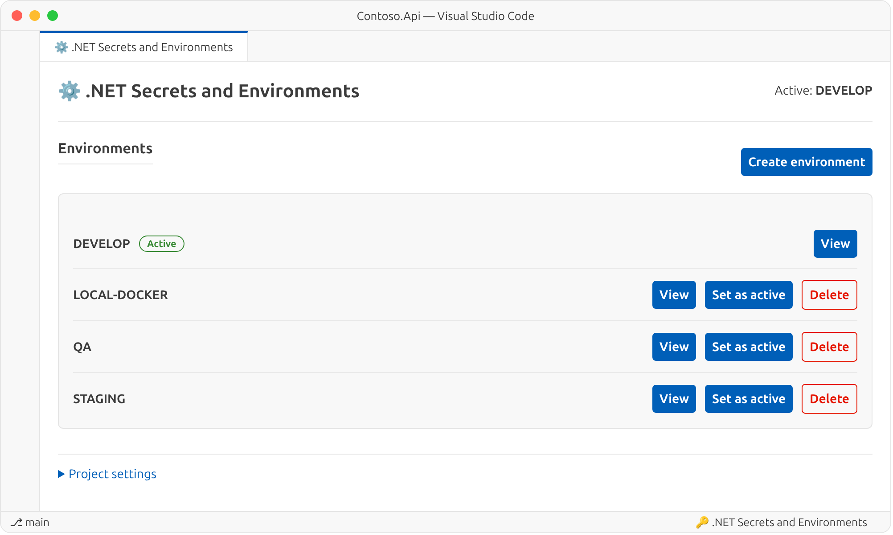
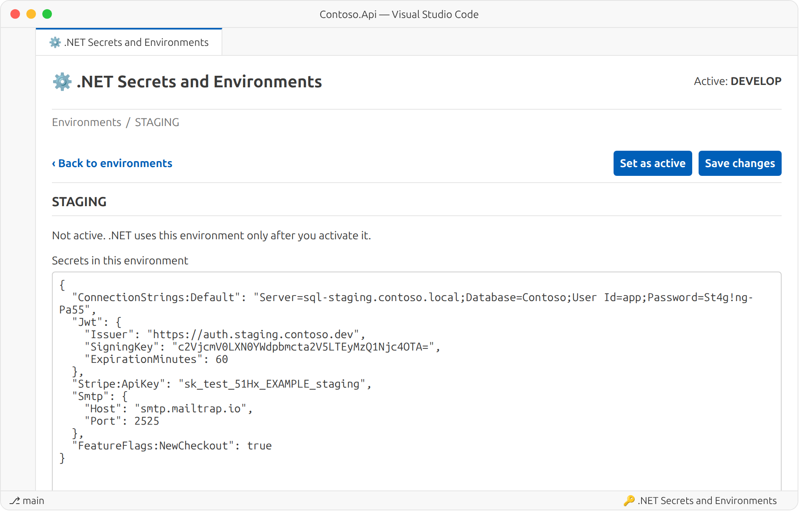
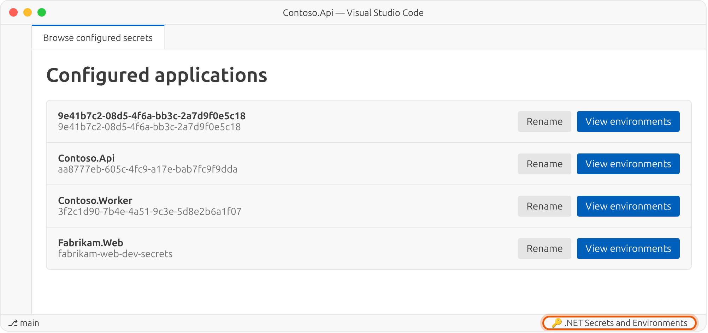
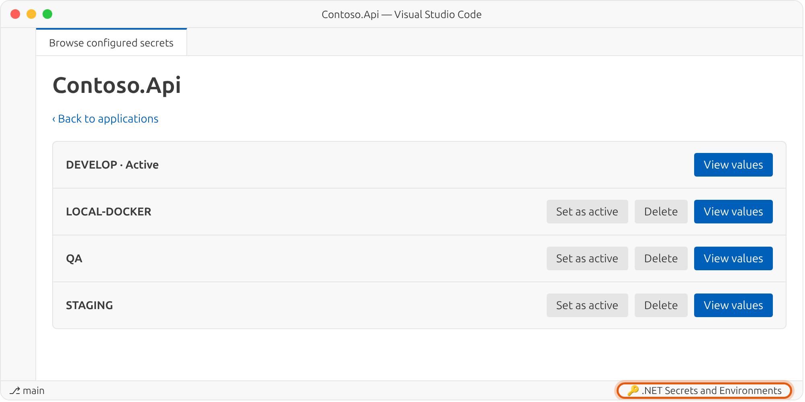
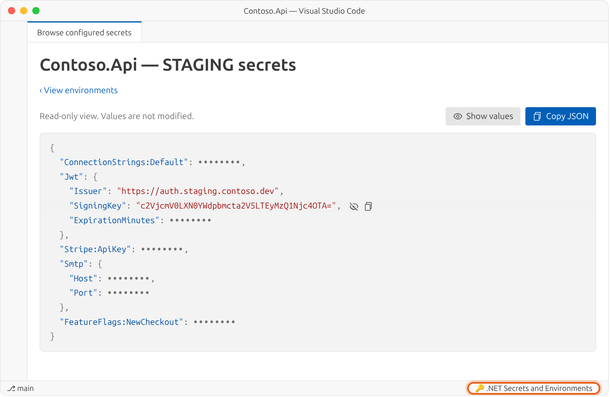

<p align="center">
  <picture>
    <source media="(prefers-color-scheme: dark)" srcset="https://raw.githubusercontent.com/jimovellan/net-secrets-management/main/images/logo-dark.png">
    <source media="(prefers-color-scheme: light)" srcset="https://raw.githubusercontent.com/jimovellan/net-secrets-management/main/images/logo-light.png">
    
  </picture>
</p>

<p align="center">
  <a href="https://github.com/jimovellan/net-secrets-management/blob/main/README.md">English</a> ·
  <a href="https://github.com/jimovellan/net-secrets-management/blob/main/README.es.md">Español</a> ·
  <a href="https://github.com/jimovellan/net-secrets-management/blob/main/README.zh-CN.md">简体中文</a> ·
  <a href="https://github.com/jimovellan/net-secrets-management/blob/main/README.hi.md">हिन्दी</a> ·
  <a href="https://github.com/jimovellan/net-secrets-management/blob/main/README.fr.md">Français</a> ·
  <b>العربية</b> ·
  <a href="https://github.com/jimovellan/net-secrets-management/blob/main/README.bn.md">বাংলা</a> ·
  <a href="https://github.com/jimovellan/net-secrets-management/blob/main/README.pt-BR.md">Português (Brasil)</a> ·
  <a href="https://github.com/jimovellan/net-secrets-management/blob/main/README.ru.md">Русский</a> ·
  <a href="https://github.com/jimovellan/net-secrets-management/blob/main/README.ur.md">اردو</a>
</p>

إضافة لـ VS Code تتيح الاحتفاظ بعدة **بيئات** (develop وqa وstaging…) من [.NET User Secrets](https://learn.microsoft.com/aspnet/core/security/app-secrets) لكل مشروع، والتبديل بينها بنقرة واحدة.

## الميزات

- **عدة بيئات لكل مشروع**: تُحفظ كل بيئة في الملف `secrets.<البيئة>.json` بجوار `secrets.json` الذي يستخدمه .NET.
- **تفعيل بنقرة واحدة**: تُنسخ البيئة النشطة إلى `secrets.json`، فيستخدمها `dotnet run` دون أي تعديل في الشيفرة.
- **محرر JSON مدمج** مع التحقق من الصحة، والحماية من فقدان التغييرات غير المحفوظة، وإنشاء بيئات فارغة أو منسوخة من بيئة أخرى.
- **حذف البيئات** مع طلب التأكيد. البيئة النشطة وآخر بيئة في المشروع محميتان.
- **مستعرض الأسرار المهيأة** لجميع التطبيقات التي لديها User Secrets على الجهاز: أعد تسمية المشاريع التي تعرض المعرّف فقط، وفعّل البيئات أو احذفها، واعرض القيم بصيغة JSON ملونة ومخفية افتراضيًا، مع أزرار لنسخ كل قيمة أو ملف JSON كاملًا.
- **10 لغات للواجهة**: English و简体中文 وहिन्दी وEspañol وFrançais والعربية وবাংলা وPortuguês (Brasil) وРусский واردو (مع تخطيط من اليمين إلى اليسار).

## لقطات الشاشة

**قائمة البيئات:** تظهر البيئة النشطة مميّزة، ويمكن تفعيل أي بيئة أخرى من القائمة مباشرة.

<picture>
  <source media="(prefers-color-scheme: dark)" srcset="https://raw.githubusercontent.com/jimovellan/net-secrets-management/main/images/environments-dark.png">
  <source media="(prefers-color-scheme: light)" srcset="https://raw.githubusercontent.com/jimovellan/net-secrets-management/main/images/environments-light.png">
  
</picture>

**محرر الأسرار:** عدّل ملف JSON الخاص ببيئة ما دون تفعيلها.

<picture>
  <source media="(prefers-color-scheme: dark)" srcset="https://raw.githubusercontent.com/jimovellan/net-secrets-management/main/images/editor-dark.png">
  <source media="(prefers-color-scheme: light)" srcset="https://raw.githubusercontent.com/jimovellan/net-secrets-management/main/images/editor-light.png">
  
</picture>

**مستعرض الأسرار المُعدّة:** يُفتح من شريط الحالة ويعرض جميع التطبيقات على الجهاز. يمكن إعادة تسمية المشاريع التي تعرض المعرّف فقط.

<picture>
  <source media="(prefers-color-scheme: dark)" srcset="https://raw.githubusercontent.com/jimovellan/net-secrets-management/main/images/browser-dark.png">
  <source media="(prefers-color-scheme: light)" srcset="https://raw.githubusercontent.com/jimovellan/net-secrets-management/main/images/browser-light.png">
  
</picture>

**بيئات التطبيق:** فعّل أي بيئة أو احذفها دون فتح مشروعها.

<picture>
  <source media="(prefers-color-scheme: dark)" srcset="https://raw.githubusercontent.com/jimovellan/net-secrets-management/main/images/browser-environments-dark.png">
  <source media="(prefers-color-scheme: light)" srcset="https://raw.githubusercontent.com/jimovellan/net-secrets-management/main/images/browser-environments-light.png">
  
</picture>

**عرض الأسرار:** JSON ملون والقيم مخفية افتراضيًا؛ أظهر كل قيمة أو انسخها، أو انسخ JSON كاملًا.

<picture>
  <source media="(prefers-color-scheme: dark)" srcset="https://raw.githubusercontent.com/jimovellan/net-secrets-management/main/images/secrets-dark.png">
  <source media="(prefers-color-scheme: light)" srcset="https://raw.githubusercontent.com/jimovellan/net-secrets-management/main/images/secrets-light.png">
  
</picture>

> تعرض اللقطات الواجهة باللغة الإنجليزية. غيّر اللغة من الإعداد `net-secrets-manager.language`.

## المتطلبات

- VS Code 1.142 أو أحدث.
- مشروع .NET يحتوي على ملف `.csproj`.
- عنصر `UserSecretsId` داخل `.csproj`. إذا لم يكن موجودًا، فشغّل الأمر التالي من مجلد المشروع:

```bash
dotnet user-secrets init
```

## البدء السريع

1. انقر بزر الفأرة الأيمن على ملف `.csproj` في المستكشف واختر **فتح مدير أسرار .NET** (أو شغّل الأمر نفسه من لوحة الأوامر بينما `.csproj` مفتوح في المحرر).
2. تُنشأ البيئة `DEVELOP` تلقائيًا. إذا كان `secrets.json` موجودًا مسبقًا، فسيُستخدم محتواه نقطةَ بداية.
3. انقر **إنشاء بيئة**، واكتب اسمًا (`qa` أو `staging` أو `local-docker`…) واختر نسخ الأسرار من بيئة أخرى أو البدء ببيئة فارغة.
4. انقر **عرض** لتعديل JSON ثم **حفظ التغييرات** لحفظه.
5. انقر **تعيين كنشطة** ليستخدم .NET هذه البيئة.

للعمل مع جميع التطبيقات، انقر **🔑 مدير أسرار وبيئات .NET** في شريط الحالة أو شغّل **استعراض الأسرار المُعدّة**. يمكنك من هناك **إعادة التسمية** لمشروع، أو **تعيين كنشطة** أو **حذف** بيئة، وفتح **عرض القيم** لإظهار الأسرار ونسخها.

## مثال

مشروع المثال `Contoso.Api.csproj`:

```xml
<Project Sdk="Microsoft.NET.Sdk.Web">
  <PropertyGroup>
    <TargetFramework>net10.0</TargetFramework>
    <UserSecretsId>aa8777eb-605c-4fc9-a17e-bab7fc9f9dda</UserSecretsId>
  </PropertyGroup>
</Project>
```

بعد إنشاء البيئتين `qa` و`staging` يصبح مجلد User Secrets كما يلي:

```text
~/.microsoft/usersecrets/aa8777eb-605c-4fc9-a17e-bab7fc9f9dda/
├── .active-env              # البيئة النشطة والاسم المعروض
├── secrets.json             # نسخة من البيئة النشطة (يقرؤها .NET)
├── secrets.develop.json
├── secrets.qa.json
└── secrets.staging.json
```

`.active-env`:

```json
{
  "env": "develop",
  "projectName": "Contoso.Api"
}
```

`secrets.staging.json` (بيانات مثال):

```json
{
  "ConnectionStrings:Default": "Server=sql-staging.contoso.local;Database=Contoso;User Id=app;Password=St4g!ng-Pa55",
  "Jwt:Issuer": "https://auth.staging.contoso.dev",
  "Jwt:SigningKey": "c2VjcmV0LXN0YWdpbmcta2V5LTEyMzQ1Njc4OTA=",
  "Stripe:ApiKey": "sk_test_51Hx_EXAMPLE_staging",
  "Smtp:Host": "smtp.mailtrap.io",
  "FeatureFlags:NewCheckout": "true"
}
```

لا تتغير شيفرة التطبيق، إذ تواصل قراءة User Secrets كالمعتاد:

```csharp
var builder = WebApplication.CreateBuilder(args); // loads User Secrets in Development
var connectionString = builder.Configuration.GetConnectionString("Default");
var issuer = builder.Configuration["Jwt:Issuer"];
```

عند تفعيل `staging` يُنسخ محتواها إلى `secrets.json`، ويستخدم `dotnet run` التالي هذه القيم.

## الإعدادات

| الإعداد | القيم | الافتراضي | الوصف |
| --- | --- | --- | --- |
| `net-secrets-manager.language` | `auto`, `en`, `zh-CN`, `hi`, `es`, `fr`, `ar`, `bn`, `pt-BR`, `ru`, `ur` | `en` | لغة الواجهة. القيمة `auto` تتبع لغة عرض VS Code. |

```json
{
  "net-secrets-manager.language": "ar"
}
```

## الأوامر

| الأمر | المكان | الوظيفة |
| --- | --- | --- |
| **فتح مدير أسرار .NET** | قائمة `.csproj` السياقية، لوحة الأوامر | يفتح مدير البيئات لذلك المشروع. |
| **استعراض الأسرار المُعدّة** | شريط الحالة، لوحة الأوامر | يعرض التطبيقات والبيئات: إعادة تسمية المشاريع، وتفعيل البيئات أو حذفها، وعرض القيم أو نسخها. |

## آلية العمل

- **الموقع**: تُحفظ الملفات بجوار `secrets.json` الخاص بـ .NET User Secrets:
  - Windows: `%APPDATA%\Microsoft\UserSecrets\<UserSecretsId>\`
  - Linux وmacOS: `~/.microsoft/usersecrets/<UserSecretsId>/`
- **المزامنة**: عند حفظ البيئة النشطة يُحدَّث `secrets.json` أيضًا. وإذا عدّلت `secrets.json` مباشرة في VS Code وحفظته، تُنسخ التغييرات إلى البيئة النشطة.
- **الأسماء**: لا تقبل أسماء البيئات إلا الأحرف والأرقام والشرطات والشرطات السفلية، وتُحفظ بأحرف صغيرة.
- **الحذف**: حذف بيئة يزيل ملف `secrets.<البيئة>.json` الخاص بها بعد التأكيد. لا يمكن حذف البيئة النشطة (فعّل بيئة أخرى أولًا)، ولا آخر بيئة في المشروع.
- **الاسم المعروض**: إعادة تسمية المشروع تحفظ `projectName` في `.active-env` فقط، ولا تُعدَّل ملفات الأسرار.
- **الترحيل**: إذا وُجدت ملفات `.active-env` أو `secrets.json` أو `secrets.*.json` في مجلد المشروع، فإنها تُنقل إلى مخزن User Secrets. لا تُستبدل الملفات الموجودة أبدًا، وبدلًا من ذلك يظهر تحذير.

## الأمان

> [!WARNING]
> الملفات **غير مشفرة**، تمامًا كما في .NET User Secrets. استخدم هذه الإضافة لأسرار التطوير فقط، واحمِ حساب نظام التشغيل الذي تُخزَّن فيه. لا تستخدمها لبيانات اعتماد بيئة الإنتاج.
