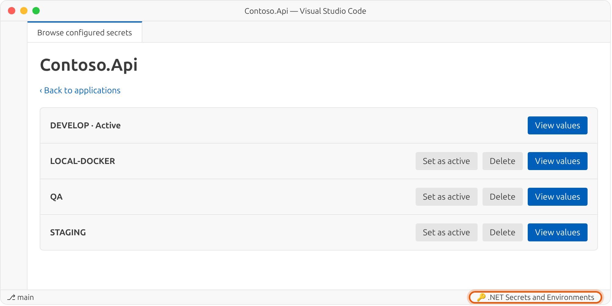
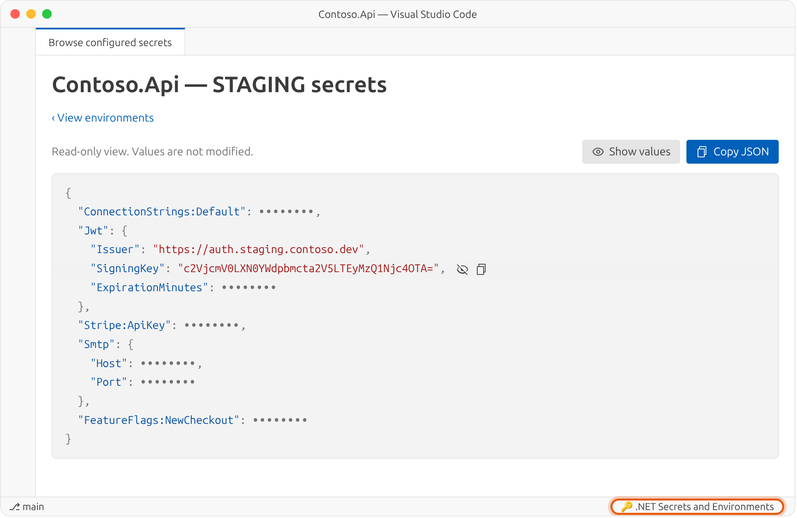

<p align="center">
  <picture>
    <source media="(prefers-color-scheme: dark)" srcset="https://raw.githubusercontent.com/jimovellan/net-secrets-management/main/images/logo-dark.png">
    <source media="(prefers-color-scheme: light)" srcset="https://raw.githubusercontent.com/jimovellan/net-secrets-management/main/images/logo-light.png">
    
  </picture>
</p>

<p align="center">
  <a href="https://github.com/jimovellan/net-secrets-management/blob/main/README.md">English</a> ·
  <a href="https://github.com/jimovellan/net-secrets-management/blob/main/README.es.md">Español</a> ·
  <a href="https://github.com/jimovellan/net-secrets-management/blob/main/README.zh-CN.md">简体中文</a> ·
  <a href="https://github.com/jimovellan/net-secrets-management/blob/main/README.hi.md">हिन्दी</a> ·
  <b>Français</b> ·
  <a href="https://github.com/jimovellan/net-secrets-management/blob/main/README.ar.md">العربية</a> ·
  <a href="https://github.com/jimovellan/net-secrets-management/blob/main/README.bn.md">বাংলা</a> ·
  <a href="https://github.com/jimovellan/net-secrets-management/blob/main/README.pt-BR.md">Português (Brasil)</a> ·
  <a href="https://github.com/jimovellan/net-secrets-management/blob/main/README.ru.md">Русский</a> ·
  <a href="https://github.com/jimovellan/net-secrets-management/blob/main/README.ur.md">اردو</a>
</p>

Extension VS Code permettant de gérer plusieurs **environnements** (develop, qa, staging…) de [.NET User Secrets](https://learn.microsoft.com/aspnet/core/security/app-secrets) par projet et de passer de l’un à l’autre en un clic.

## Fonctionnalités

- **Plusieurs environnements par projet** : chacun est enregistré sous `secrets.<environnement>.json`, à côté du `secrets.json` utilisé par .NET.
- **Activation en un clic** : l’environnement actif est copié dans `secrets.json`, donc `dotnet run` l’utilise sans modifier le code.
- **Éditeur JSON intégré** avec validation, protection contre la perte de modifications non enregistrées et création d’environnements vides ou copiés depuis un autre.
- **Suppression d’environnements** avec confirmation. L’environnement actif et le dernier environnement d’un projet sont protégés.
- **Navigateur des secrets configurés** pour toutes les applications de la machine qui ont des User Secrets : renommez les projets qui n’affichent que leur identifiant, activez ou supprimez des environnements, et consultez les valeurs en JSON coloré, masquées par défaut, avec des boutons pour copier chaque valeur ou le JSON complet.
- **10 langues d’interface** : English, 简体中文, हिन्दी, Español, Français, العربية, বাংলা, Português (Brasil), Русский et اردو (avec mise en page de droite à gauche).

## Captures d’écran

**Liste des environnements :** l’environnement actif est signalé et tout autre peut être activé depuis la liste.

<picture>
  <source media="(prefers-color-scheme: dark)" srcset="https://raw.githubusercontent.com/jimovellan/net-secrets-management/main/images/environments-dark.png">
  <source media="(prefers-color-scheme: light)" srcset="https://raw.githubusercontent.com/jimovellan/net-secrets-management/main/images/environments-light.png">
  
</picture>

**Éditeur de secrets :** modifiez le JSON d’un environnement sans l’activer.

<picture>
  <source media="(prefers-color-scheme: dark)" srcset="https://raw.githubusercontent.com/jimovellan/net-secrets-management/main/images/editor-dark.png">
  <source media="(prefers-color-scheme: light)" srcset="https://raw.githubusercontent.com/jimovellan/net-secrets-management/main/images/editor-light.png">
  
</picture>

**Navigateur de secrets configurés :** ouvert depuis la barre d’état, il liste toutes les applications de la machine. Les projets qui n’affichent que leur identifiant peuvent être renommés.

<picture>
  <source media="(prefers-color-scheme: dark)" srcset="https://raw.githubusercontent.com/jimovellan/net-secrets-management/main/images/browser-dark.png">
  <source media="(prefers-color-scheme: light)" srcset="https://raw.githubusercontent.com/jimovellan/net-secrets-management/main/images/browser-light.png">
  
</picture>

**Environnements d’une application :** activez ou supprimez n’importe quel environnement sans ouvrir son projet.

<picture>
  <source media="(prefers-color-scheme: dark)" srcset="https://raw.githubusercontent.com/jimovellan/net-secrets-management/main/images/browser-environments-dark.png">
  <source media="(prefers-color-scheme: light)" srcset="https://raw.githubusercontent.com/jimovellan/net-secrets-management/main/images/browser-environments-light.png">
  
</picture>

**Vue des secrets :** JSON coloré avec des valeurs masquées par défaut ; révélez ou copiez chaque valeur, ou copiez le JSON complet.

<picture>
  <source media="(prefers-color-scheme: dark)" srcset="https://raw.githubusercontent.com/jimovellan/net-secrets-management/main/images/secrets-dark.png">
  <source media="(prefers-color-scheme: light)" srcset="https://raw.githubusercontent.com/jimovellan/net-secrets-management/main/images/secrets-light.png">
  
</picture>

> Les captures montrent l’interface en anglais. Changez la langue avec le paramètre `net-secrets-manager.language`.

## Prérequis

- VS Code 1.142 ou ultérieur.
- Un projet .NET avec un fichier `.csproj`.
- Un élément `UserSecretsId` dans le `.csproj`. S’il manque, exécutez depuis le dossier du projet :

```bash
dotnet user-secrets init
```

## Démarrage rapide

1. Faites un clic droit sur votre `.csproj` dans l’Explorateur et choisissez **Ouvrir le gestionnaire de secrets .NET** (ou lancez cette commande depuis la palette de commandes avec le `.csproj` ouvert dans l’éditeur).
2. L’environnement `DEVELOP` est créé automatiquement. Si `secrets.json` existait déjà, son contenu sert de point de départ.
3. Cliquez sur **Créer un environnement**, saisissez un nom (`qa`, `staging`, `local-docker`…) et choisissez de copier les secrets d’un autre environnement ou de partir de zéro.
4. Cliquez sur **Afficher** pour modifier le JSON, puis sur **Enregistrer les modifications**.
5. Cliquez sur **Définir comme actif** pour que .NET utilise cet environnement.

Pour travailler avec toutes les applications, cliquez sur **🔑 Gestionnaire de secrets et d’environnements .NET** dans la barre d’état ou exécutez **Parcourir les secrets configurés**. Vous pouvez y **Renommer** un projet, **Définir comme actif** ou **Supprimer** un environnement, et ouvrir **Afficher les valeurs** pour révéler et copier les secrets.

## Exemple

Projet d’exemple `Contoso.Api.csproj` :

```xml
<Project Sdk="Microsoft.NET.Sdk.Web">
  <PropertyGroup>
    <TargetFramework>net10.0</TargetFramework>
    <UserSecretsId>aa8777eb-605c-4fc9-a17e-bab7fc9f9dda</UserSecretsId>
  </PropertyGroup>
</Project>
```

Après la création des environnements `qa` et `staging`, le dossier User Secrets ressemble à ceci :

```text
~/.microsoft/usersecrets/aa8777eb-605c-4fc9-a17e-bab7fc9f9dda/
├── .active-env              # environnement actif et nom affiché
├── secrets.json             # copie de l’environnement actif (lu par .NET)
├── secrets.develop.json
├── secrets.qa.json
└── secrets.staging.json
```

`.active-env` :

```json
{
  "env": "develop",
  "projectName": "Contoso.Api"
}
```

`secrets.staging.json` (données d’exemple) :

```json
{
  "ConnectionStrings:Default": "Server=sql-staging.contoso.local;Database=Contoso;User Id=app;Password=St4g!ng-Pa55",
  "Jwt:Issuer": "https://auth.staging.contoso.dev",
  "Jwt:SigningKey": "c2VjcmV0LXN0YWdpbmcta2V5LTEyMzQ1Njc4OTA=",
  "Stripe:ApiKey": "sk_test_51Hx_EXAMPLE_staging",
  "Smtp:Host": "smtp.mailtrap.io",
  "FeatureFlags:NewCheckout": "true"
}
```

Le code de l’application ne change pas. Il lit toujours les User Secrets de la même façon :

```csharp
var builder = WebApplication.CreateBuilder(args); // charge les User Secrets en Development
var connectionString = builder.Configuration.GetConnectionString("Default");
var issuer = builder.Configuration["Jwt:Issuer"];
```

Lorsque vous activez `staging`, son contenu est copié dans `secrets.json` et le prochain `dotnet run` utilise ces valeurs.

## Paramètres

| Paramètre | Valeurs | Par défaut | Description |
| --- | --- | --- | --- |
| `net-secrets-manager.language` | `auto`, `en`, `zh-CN`, `hi`, `es`, `fr`, `ar`, `bn`, `pt-BR`, `ru`, `ur` | `en` | Langue de l’interface. `auto` suit la langue d’affichage de VS Code. |

```json
{
  "net-secrets-manager.language": "fr"
}
```

## Commandes

| Commande | Où | Rôle |
| --- | --- | --- |
| **Ouvrir le gestionnaire de secrets .NET** | Menu contextuel du `.csproj`, palette de commandes | Ouvre le gestionnaire d’environnements du projet. |
| **Parcourir les secrets configurés** | Barre d’état, palette de commandes | Liste les applications et environnements : renommer des projets, activer ou supprimer des environnements, afficher ou copier des valeurs. |

## Fonctionnement

- **Emplacement** : les fichiers sont enregistrés à côté du `secrets.json` de .NET User Secrets :
  - Windows : `%APPDATA%\Microsoft\UserSecrets\<UserSecretsId>\`
  - Linux et macOS : `~/.microsoft/usersecrets/<UserSecretsId>/`
- **Synchronisation** : enregistrer l’environnement actif met aussi à jour `secrets.json`. Si vous modifiez et enregistrez `secrets.json` directement dans VS Code, les changements sont recopiés dans l’environnement actif.
- **Noms** : les environnements n’acceptent que des lettres, des chiffres, des tirets et des traits de soulignement, et sont enregistrés en minuscules.
- **Suppression** : supprimer un environnement efface son `secrets.<environnement>.json` après confirmation. L’environnement actif ne peut pas être supprimé (activez-en un autre d’abord), pas plus que le dernier environnement d’un projet.
- **Nom affiché** : renommer un projet enregistre seulement `projectName` dans `.active-env` ; les fichiers de secrets ne sont pas modifiés.
- **Migration** : les fichiers `.active-env`, `secrets.json` ou `secrets.*.json` présents dans le dossier du projet sont déplacés vers le stockage User Secrets. Les fichiers existants ne sont jamais écrasés ; un avertissement s’affiche à la place.

## Sécurité

> [!WARNING]
> Comme avec .NET User Secrets, les fichiers **ne sont pas chiffrés**. Utilisez cette extension uniquement pour des secrets de développement et protégez le compte du système d’exploitation où ils sont stockés. Ne l’utilisez pas pour des identifiants de production.
