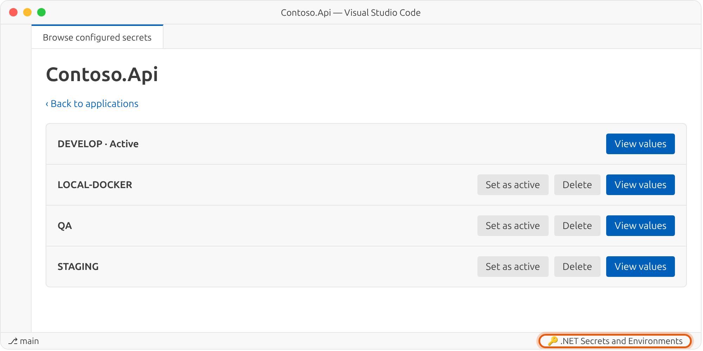
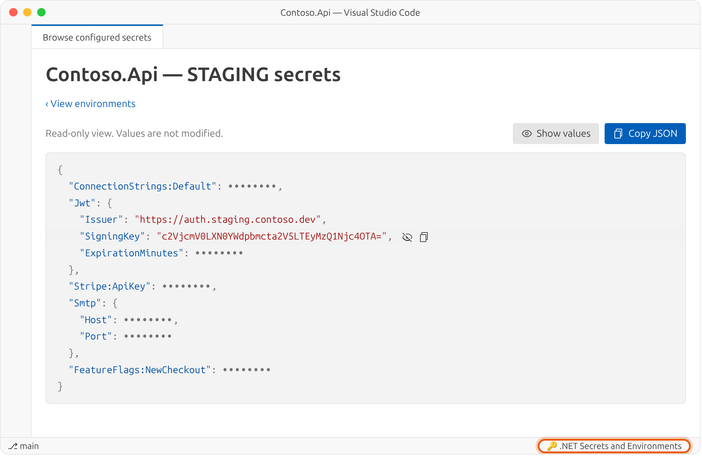

<p align="center">
  <picture>
    <source media="(prefers-color-scheme: dark)" srcset="https://raw.githubusercontent.com/jimovellan/net-secrets-management/main/images/logo-dark.png">
    <source media="(prefers-color-scheme: light)" srcset="https://raw.githubusercontent.com/jimovellan/net-secrets-management/main/images/logo-light.png">
    
  </picture>
</p>

<p align="center">
  <a href="https://github.com/jimovellan/net-secrets-management/blob/main/README.md">English</a> ·
  <a href="https://github.com/jimovellan/net-secrets-management/blob/main/README.es.md">Español</a> ·
  <a href="https://github.com/jimovellan/net-secrets-management/blob/main/README.zh-CN.md">简体中文</a> ·
  <b>हिन्दी</b> ·
  <a href="https://github.com/jimovellan/net-secrets-management/blob/main/README.fr.md">Français</a> ·
  <a href="https://github.com/jimovellan/net-secrets-management/blob/main/README.ar.md">العربية</a> ·
  <a href="https://github.com/jimovellan/net-secrets-management/blob/main/README.bn.md">বাংলা</a> ·
  <a href="https://github.com/jimovellan/net-secrets-management/blob/main/README.pt-BR.md">Português (Brasil)</a> ·
  <a href="https://github.com/jimovellan/net-secrets-management/blob/main/README.ru.md">Русский</a> ·
  <a href="https://github.com/jimovellan/net-secrets-management/blob/main/README.ur.md">اردو</a>
</p>

एक VS Code एक्सटेंशन, जो हर प्रोजेक्ट के लिए [.NET User Secrets](https://learn.microsoft.com/aspnet/core/security/app-secrets) के कई **एनवायरनमेंट** (develop, qa, staging…) रखता है और एक क्लिक में उनके बीच स्विच करने देता है।

## विशेषताएँ

- **हर प्रोजेक्ट में कई एनवायरनमेंट**: हर एनवायरनमेंट `secrets.<एनवायरनमेंट>.json` के रूप में .NET द्वारा उपयोग की जाने वाली `secrets.json` के पास सहेजा जाता है।
- **एक क्लिक में सक्रिय करें**: सक्रिय एनवायरनमेंट `secrets.json` में कॉपी होता है, इसलिए `dotnet run` बिना कोड बदले उसे उपयोग करता है।
- **बिल्ट-इन JSON एडिटर**: वैलिडेशन, बिना सहेजे बदलावों की सुरक्षा, और खाली या किसी दूसरे एनवायरनमेंट की कॉपी से नया एनवायरनमेंट बनाना।
- **एनवायरनमेंट हटाना**: पुष्टि के साथ। सक्रिय एनवायरनमेंट और प्रोजेक्ट का अंतिम एनवायरनमेंट सुरक्षित रहते हैं।
- **कॉन्फ़िगर किए गए सीक्रेट का ब्राउज़र**: मशीन पर User Secrets वाले सभी ऐप्लिकेशन के लिए। केवल ID दिखाने वाले प्रोजेक्ट का नाम बदलें, एनवायरनमेंट सक्रिय करें या हटाएं, और मानों को रंगीन JSON में देखें — डिफ़ॉल्ट रूप से छिपे हुए, हर मान या पूरे JSON को कॉपी करने के बटन के साथ।
- **10 इंटरफ़ेस भाषाएँ**: English, 简体中文, हिन्दी, Español, Français, العربية, বাংলা, Português (Brasil), Русский और اردو (दाएँ से बाएँ लेआउट सहित)।

## स्क्रीनशॉट

**एनवायरनमेंट सूची:** सक्रिय एनवायरनमेंट चिह्नित होता है और किसी अन्य को सूची से ही सक्रिय किया जा सकता है।

<picture>
  <source media="(prefers-color-scheme: dark)" srcset="https://raw.githubusercontent.com/jimovellan/net-secrets-management/main/images/environments-dark.png">
  <source media="(prefers-color-scheme: light)" srcset="https://raw.githubusercontent.com/jimovellan/net-secrets-management/main/images/environments-light.png">
  
</picture>

**सीक्रेट एडिटर:** किसी एनवायरनमेंट को सक्रिय किए बिना उसका JSON संपादित करें।

<picture>
  <source media="(prefers-color-scheme: dark)" srcset="https://raw.githubusercontent.com/jimovellan/net-secrets-management/main/images/editor-dark.png">
  <source media="(prefers-color-scheme: light)" srcset="https://raw.githubusercontent.com/jimovellan/net-secrets-management/main/images/editor-light.png">
  
</picture>

**कॉन्फ़िगर किए गए सीक्रेट का ब्राउज़र:** स्टेटस बार से खुलता है और मशीन के सभी एप्लिकेशन दिखाता है। केवल ID दिखाने वाले प्रोजेक्ट का नाम बदला जा सकता है।

<picture>
  <source media="(prefers-color-scheme: dark)" srcset="https://raw.githubusercontent.com/jimovellan/net-secrets-management/main/images/browser-dark.png">
  <source media="(prefers-color-scheme: light)" srcset="https://raw.githubusercontent.com/jimovellan/net-secrets-management/main/images/browser-light.png">
  
</picture>

**किसी ऐप्लिकेशन के एनवायरनमेंट:** प्रोजेक्ट खोले बिना कोई भी एनवायरनमेंट सक्रिय करें या हटाएं।

<picture>
  <source media="(prefers-color-scheme: dark)" srcset="https://raw.githubusercontent.com/jimovellan/net-secrets-management/main/images/browser-environments-dark.png">
  <source media="(prefers-color-scheme: light)" srcset="https://raw.githubusercontent.com/jimovellan/net-secrets-management/main/images/browser-environments-light.png">
  
</picture>

**सीक्रेट व्यू:** रंगीन JSON, मान डिफ़ॉल्ट रूप से छिपे हुए; हर मान दिखाएं या कॉपी करें, या पूरा JSON कॉपी करें।

<picture>
  <source media="(prefers-color-scheme: dark)" srcset="https://raw.githubusercontent.com/jimovellan/net-secrets-management/main/images/secrets-dark.png">
  <source media="(prefers-color-scheme: light)" srcset="https://raw.githubusercontent.com/jimovellan/net-secrets-management/main/images/secrets-light.png">
  
</picture>

> स्क्रीनशॉट अंग्रेज़ी इंटरफ़ेस दिखाते हैं। भाषा `net-secrets-manager.language` सेटिंग से बदलें।

## आवश्यकताएँ

- VS Code 1.142 या नया।
- `.csproj` फ़ाइल वाला .NET प्रोजेक्ट।
- `.csproj` में `UserSecretsId` एलिमेंट। अगर यह नहीं है, तो प्रोजेक्ट फ़ोल्डर में चलाएँ:

```bash
dotnet user-secrets init
```

## त्वरित शुरुआत

1. Explorer में अपनी `.csproj` पर राइट-क्लिक करें और **.NET सीक्रेट मैनेजर खोलें** चुनें (या `.csproj` एडिटर में खुली होने पर Command Palette से यही कमांड चलाएँ)।
2. `DEVELOP` एनवायरनमेंट अपने आप बनता है। अगर `secrets.json` पहले से है, तो उसकी सामग्री शुरुआती डेटा के रूप में उपयोग होती है।
3. **एनवायरनमेंट बनाएँ** पर क्लिक करें, नाम लिखें (`qa`, `staging`, `local-docker`…) और चुनें कि किसी दूसरे एनवायरनमेंट से सीक्रेट कॉपी करने हैं या खाली शुरू करना है।
4. JSON संपादित करने के लिए **देखें** और सहेजने के लिए **बदलाव सहेजें** पर क्लिक करें।
5. .NET से वह एनवायरनमेंट उपयोग करवाने के लिए **सक्रिय करें** पर क्लिक करें।

सभी ऐप्लिकेशन के साथ काम करने के लिए, स्टेटस बार में **🔑 .NET सीक्रेट और एनवायरनमेंट** पर क्लिक करें या **कॉन्फ़िगर किए गए सीक्रेट देखें** चलाएं। वहां आप प्रोजेक्ट का **नाम बदलें**, एनवायरनमेंट को **सक्रिय करें** या **हटाएं**, और सीक्रेट दिखाने व कॉपी करने के लिए **सीक्रेट मान देखें** खोल सकते हैं।

## उदाहरण

उदाहरण प्रोजेक्ट `Contoso.Api.csproj`:

```xml
<Project Sdk="Microsoft.NET.Sdk.Web">
  <PropertyGroup>
    <TargetFramework>net10.0</TargetFramework>
    <UserSecretsId>aa8777eb-605c-4fc9-a17e-bab7fc9f9dda</UserSecretsId>
  </PropertyGroup>
</Project>
```

`qa` और `staging` एनवायरनमेंट बनाने के बाद User Secrets फ़ोल्डर ऐसा दिखता है:

```text
~/.microsoft/usersecrets/aa8777eb-605c-4fc9-a17e-bab7fc9f9dda/
├── .active-env              # सक्रिय एनवायरनमेंट और प्रदर्शित नाम
├── secrets.json             # सक्रिय एनवायरनमेंट की कॉपी (.NET इसे पढ़ता है)
├── secrets.develop.json
├── secrets.qa.json
└── secrets.staging.json
```

`.active-env`:

```json
{
  "env": "develop",
  "projectName": "Contoso.Api"
}
```

`secrets.staging.json` (उदाहरण डेटा):

```json
{
  "ConnectionStrings:Default": "Server=sql-staging.contoso.local;Database=Contoso;User Id=app;Password=St4g!ng-Pa55",
  "Jwt:Issuer": "https://auth.staging.contoso.dev",
  "Jwt:SigningKey": "c2VjcmV0LXN0YWdpbmcta2V5LTEyMzQ1Njc4OTA=",
  "Stripe:ApiKey": "sk_test_51Hx_EXAMPLE_staging",
  "Smtp:Host": "smtp.mailtrap.io",
  "FeatureFlags:NewCheckout": "true"
}
```

एप्लिकेशन का कोड नहीं बदलता; वह पहले की तरह User Secrets पढ़ता है:

```csharp
var builder = WebApplication.CreateBuilder(args); // Development में User Secrets लोड करता है
var connectionString = builder.Configuration.GetConnectionString("Default");
var issuer = builder.Configuration["Jwt:Issuer"];
```

`staging` सक्रिय करने पर उसकी सामग्री `secrets.json` में आ जाती है और अगला `dotnet run` वही मान उपयोग करता है।

## सेटिंग

| सेटिंग | मान | डिफ़ॉल्ट | विवरण |
| --- | --- | --- | --- |
| `net-secrets-manager.language` | `auto`, `en`, `zh-CN`, `hi`, `es`, `fr`, `ar`, `bn`, `pt-BR`, `ru`, `ur` | `en` | इंटरफ़ेस की भाषा। `auto` VS Code की डिस्प्ले भाषा का पालन करता है। |

```json
{
  "net-secrets-manager.language": "hi"
}
```

## कमांड

| कमांड | कहाँ | क्या करता है |
| --- | --- | --- |
| **.NET सीक्रेट मैनेजर खोलें** | `.csproj` का संदर्भ मेनू, Command Palette | उस प्रोजेक्ट का एनवायरनमेंट मैनेजर खोलता है। |
| **कॉन्फ़िगर किए गए सीक्रेट देखें** | स्टेटस बार, Command Palette | ऐप्लिकेशन और एनवायरनमेंट की सूची: प्रोजेक्ट का नाम बदलें, एनवायरनमेंट सक्रिय करें या हटाएं, और मान देखें या कॉपी करें। |

## यह कैसे काम करता है

- **स्थान**: फ़ाइलें .NET User Secrets की `secrets.json` के पास सहेजी जाती हैं:
  - Windows: `%APPDATA%\Microsoft\UserSecrets\<UserSecretsId>\`
  - Linux और macOS: `~/.microsoft/usersecrets/<UserSecretsId>/`
- **सिंक**: सक्रिय एनवायरनमेंट सहेजने पर `secrets.json` भी अपडेट होती है। अगर आप VS Code में सीधे `secrets.json` संपादित करके सहेजते हैं, तो बदलाव सक्रिय एनवायरनमेंट में वापस कॉपी होते हैं।
- **नाम**: एनवायरनमेंट नाम में केवल अक्षर, अंक, हाइफ़न और अंडरस्कोर हो सकते हैं, और वे छोटे अक्षरों में सहेजे जाते हैं।
- **हटाना**: पुष्टि के बाद एनवायरनमेंट हटाने पर उसकी `secrets.<एनवायरनमेंट>.json` फ़ाइल हट जाती है। सक्रिय एनवायरनमेंट नहीं हटाया जा सकता (पहले कोई दूसरा सक्रिय करें), और न ही प्रोजेक्ट का अंतिम एनवायरनमेंट।
- **प्रदर्शित नाम**: प्रोजेक्ट का नाम बदलने से केवल `.active-env` में `projectName` सहेजा जाता है; सीक्रेट फ़ाइलें नहीं बदलतीं।
- **माइग्रेशन**: अगर प्रोजेक्ट फ़ोल्डर में `.active-env`, `secrets.json` या `secrets.*.json` फ़ाइलें हैं, तो वे User Secrets स्टोर में ले जाई जाती हैं। मौजूदा फ़ाइलें कभी ओवरराइट नहीं होतीं; ऐसे में चेतावनी दिखाई जाती है।

## सुरक्षा

> [!WARNING]
> .NET User Secrets की तरह फ़ाइलें **एन्क्रिप्ट नहीं होतीं**। इस एक्सटेंशन का उपयोग केवल डेवलपमेंट सीक्रेट के लिए करें और उस ऑपरेटिंग सिस्टम खाते को सुरक्षित रखें जहाँ वे सहेजे जाते हैं। प्रोडक्शन क्रेडेंशियल के लिए इसका उपयोग न करें।
