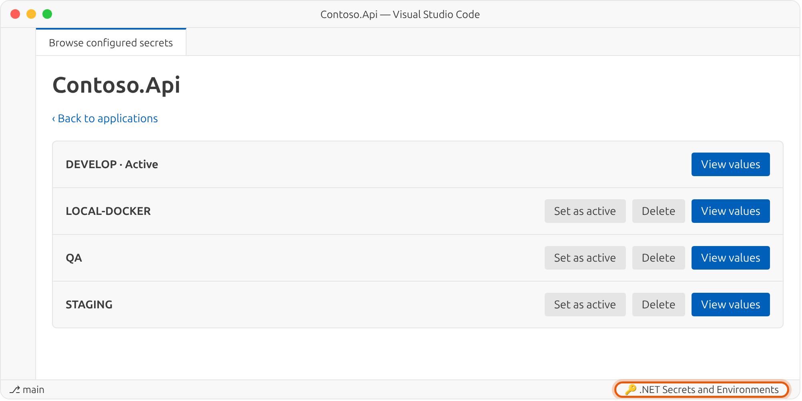
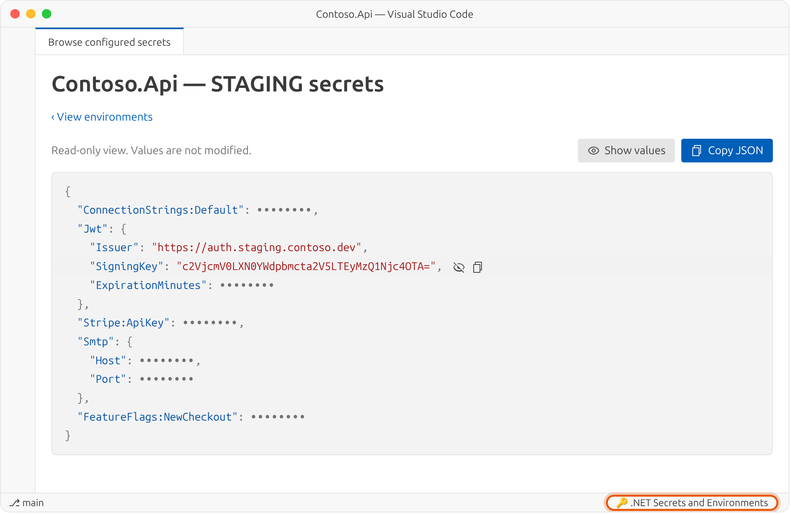

<p align="center">
  <picture>
    <source media="(prefers-color-scheme: dark)" srcset="https://raw.githubusercontent.com/jimovellan/net-secrets-management/main/images/logo-dark.png">
    <source media="(prefers-color-scheme: light)" srcset="https://raw.githubusercontent.com/jimovellan/net-secrets-management/main/images/logo-light.png">
    
  </picture>
</p>

<p align="center">
  <b>English</b> ·
  <a href="https://github.com/jimovellan/net-secrets-management/blob/main/README.es.md">Español</a> ·
  <a href="https://github.com/jimovellan/net-secrets-management/blob/main/README.zh-CN.md">简体中文</a> ·
  <a href="https://github.com/jimovellan/net-secrets-management/blob/main/README.hi.md">हिन्दी</a> ·
  <a href="https://github.com/jimovellan/net-secrets-management/blob/main/README.fr.md">Français</a> ·
  <a href="https://github.com/jimovellan/net-secrets-management/blob/main/README.ar.md">العربية</a> ·
  <a href="https://github.com/jimovellan/net-secrets-management/blob/main/README.bn.md">বাংলা</a> ·
  <a href="https://github.com/jimovellan/net-secrets-management/blob/main/README.pt-BR.md">Português (Brasil)</a> ·
  <a href="https://github.com/jimovellan/net-secrets-management/blob/main/README.ru.md">Русский</a> ·
  <a href="https://github.com/jimovellan/net-secrets-management/blob/main/README.ur.md">اردو</a>
</p>

A VS Code extension for keeping several **environments** (develop, qa, staging…) of [.NET User Secrets](https://learn.microsoft.com/aspnet/core/security/app-secrets) per project and switching between them with one click.

## Features

- **Multiple environments per project**: each one is stored as `secrets.<environment>.json` next to the `secrets.json` used by .NET.
- **One-click activation**: the active environment is copied to `secrets.json`, so `dotnet run` picks it up with no code changes.
- **Built-in JSON editor** with validation, protection against losing unsaved changes, and environment creation from scratch or from a copy.
- **Environment deletion** with confirmation. The active environment and a project's last environment are protected.
- **Configured secrets browser** for every application with User Secrets on the machine: rename projects that only show their ID, activate or delete environments, and view values as colored JSON, hidden by default, with buttons to copy each value or the whole JSON.
- **10 UI languages**: English, 简体中文, हिन्दी, Español, Français, العربية, বাংলা, Português (Brasil), Русский and اردو (with right-to-left layout).

## Screenshots

**Environment list:** the active environment is marked, and any other one can be activated from the list.

<picture>
  <source media="(prefers-color-scheme: dark)" srcset="https://raw.githubusercontent.com/jimovellan/net-secrets-management/main/images/environments-dark.png">
  <source media="(prefers-color-scheme: light)" srcset="https://raw.githubusercontent.com/jimovellan/net-secrets-management/main/images/environments-light.png">
  
</picture>

**Secrets editor:** edit the JSON of an environment without activating it.

<picture>
  <source media="(prefers-color-scheme: dark)" srcset="https://raw.githubusercontent.com/jimovellan/net-secrets-management/main/images/editor-dark.png">
  <source media="(prefers-color-scheme: light)" srcset="https://raw.githubusercontent.com/jimovellan/net-secrets-management/main/images/editor-light.png">
  
</picture>

**Configured secrets browser:** opened from the status bar, it lists every application on the machine. Projects that only show their ID can be renamed.

<picture>
  <source media="(prefers-color-scheme: dark)" srcset="https://raw.githubusercontent.com/jimovellan/net-secrets-management/main/images/browser-dark.png">
  <source media="(prefers-color-scheme: light)" srcset="https://raw.githubusercontent.com/jimovellan/net-secrets-management/main/images/browser-light.png">
  
</picture>

**Environments of an application:** activate or delete any environment without opening its project.

<picture>
  <source media="(prefers-color-scheme: dark)" srcset="https://raw.githubusercontent.com/jimovellan/net-secrets-management/main/images/browser-environments-dark.png">
  <source media="(prefers-color-scheme: light)" srcset="https://raw.githubusercontent.com/jimovellan/net-secrets-management/main/images/browser-environments-light.png">
  
</picture>

**Secrets view:** colored JSON with values hidden by default; reveal or copy each value, or copy the whole JSON.

<picture>
  <source media="(prefers-color-scheme: dark)" srcset="https://raw.githubusercontent.com/jimovellan/net-secrets-management/main/images/secrets-dark.png">
  <source media="(prefers-color-scheme: light)" srcset="https://raw.githubusercontent.com/jimovellan/net-secrets-management/main/images/secrets-light.png">
  
</picture>

## Requirements

- VS Code 1.142 or later.
- A .NET project with a `.csproj` file.
- A `UserSecretsId` element in the `.csproj`. If it is missing, run this from the project folder:

```bash
dotnet user-secrets init
```

## Quick start

1. Right-click your `.csproj` in the Explorer and choose **Open .NET secrets manager** (or run that command from the Command Palette while the `.csproj` is open in the editor).
2. The `DEVELOP` environment is created automatically. If `secrets.json` already existed, its content is used as the starting point.
3. Click **Create environment**, type a name (`qa`, `staging`, `local-docker`…) and choose whether to copy secrets from another environment or start empty.
4. Click **View** to edit the JSON and **Save changes** to save it.
5. Click **Set as active** to make .NET use that environment.

To work with every application, click **🔑 .NET Secrets and Environments** in the status bar or run **Browse configured secrets**. There you can **Rename** a project, **Set as active** or **Delete** an environment, and open **View values** to reveal and copy secrets.

## Example

Example project `Contoso.Api.csproj`:

```xml
<Project Sdk="Microsoft.NET.Sdk.Web">
  <PropertyGroup>
    <TargetFramework>net10.0</TargetFramework>
    <UserSecretsId>aa8777eb-605c-4fc9-a17e-bab7fc9f9dda</UserSecretsId>
  </PropertyGroup>
</Project>
```

After creating the `qa` and `staging` environments, the User Secrets folder looks like this:

```text
~/.microsoft/usersecrets/aa8777eb-605c-4fc9-a17e-bab7fc9f9dda/
├── .active-env              # active environment and display name
├── secrets.json             # copy of the active environment (read by .NET)
├── secrets.develop.json
├── secrets.qa.json
└── secrets.staging.json
```

`.active-env`:

```json
{
  "env": "develop",
  "projectName": "Contoso.Api"
}
```

`secrets.staging.json` (example data):

```json
{
  "ConnectionStrings:Default": "Server=sql-staging.contoso.local;Database=Contoso;User Id=app;Password=St4g!ng-Pa55",
  "Jwt:Issuer": "https://auth.staging.contoso.dev",
  "Jwt:SigningKey": "c2VjcmV0LXN0YWdpbmcta2V5LTEyMzQ1Njc4OTA=",
  "Stripe:ApiKey": "sk_test_51Hx_EXAMPLE_staging",
  "Smtp:Host": "smtp.mailtrap.io",
  "FeatureFlags:NewCheckout": "true"
}
```

The application code does not change. It keeps reading User Secrets as usual:

```csharp
var builder = WebApplication.CreateBuilder(args); // loads User Secrets in Development
var connectionString = builder.Configuration.GetConnectionString("Default");
var issuer = builder.Configuration["Jwt:Issuer"];
```

When you activate `staging`, `secrets.json` gets its content, and the next `dotnet run` uses those values.

## Settings

| Setting | Values | Default | Description |
| --- | --- | --- | --- |
| `net-secrets-manager.language` | `auto`, `en`, `zh-CN`, `hi`, `es`, `fr`, `ar`, `bn`, `pt-BR`, `ru`, `ur` | `en` | UI language. `auto` follows the VS Code display language. |

```json
{
  "net-secrets-manager.language": "auto"
}
```

## Commands

| Command | Where | What it does |
| --- | --- | --- |
| **Open .NET secrets manager** | `.csproj` context menu, Command Palette | Opens the environment manager for that project. |
| **Browse configured secrets** | Status bar, Command Palette | Lists applications and environments: rename projects, activate or delete environments, and view or copy values. |

## How it works

- **Location**: files are stored next to the .NET User Secrets `secrets.json`:
  - Windows: `%APPDATA%\Microsoft\UserSecrets\<UserSecretsId>\`
  - Linux and macOS: `~/.microsoft/usersecrets/<UserSecretsId>/`
- **Sync**: when you save the active environment, `secrets.json` is updated too. If you edit `secrets.json` directly in VS Code and save it, the changes are copied back to the active environment.
- **Names**: environments only accept letters, numbers, hyphens and underscores, and are saved in lowercase.
- **Deletion**: deleting an environment removes its `secrets.<environment>.json` after confirmation. The active environment cannot be deleted (activate another one first), and neither can a project's last environment.
- **Display name**: renaming a project only saves `projectName` in `.active-env`; secrets files are not changed.
- **Migration**: if `.active-env`, `secrets.json` or `secrets.*.json` files exist in the project folder, they are moved to the User Secrets store. Existing files are never overwritten; a warning is shown instead.

## Security

> [!WARNING]
> Files are **not encrypted**, just like .NET User Secrets. Use this extension only for development secrets, and protect the operating system account where they are stored. Do not use it for production credentials.
